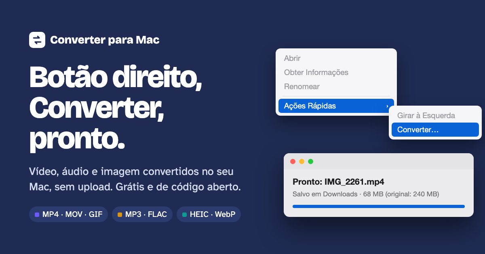

# Converter para Mac

Converta vídeo, áudio e imagem com o botão direito no Finder: **Ações Rápidas → Converter…**
Grátis, de código aberto e sem enviar nada para a internet.

**Página do projeto:** https://luiz-claudio-rj.github.io/finder-converter/



## O que ele faz

| Arquivo | Converte para |
|---|---|
| Vídeo (MOV, MKV, AVI, WebM, GIF…) | MP4 (H.264), MP4 comprimido (HEVC), MOV, WebM, GIF, MP3 ou M4A (só o áudio) |
| Áudio (WAV, M4A, AIFF, FLAC, OGG…) | MP3, M4A, WAV, FLAC, OGG |
| Imagem (HEIC, PNG, JPG, TIFF, WebP…) | JPG, PNG, WebP, HEIC, AVIF, PDF |

- **Limite de tamanho do arquivo**: 8 MB (Discord), 16 MB (WhatsApp), 25 MB (e-mail), 50 MB, 100 MB ou um valor seu. O vídeo é comprimido em duas passadas para caber no limite; se a taxa ficar baixa demais, a resolução é reduzida sozinha e a janela avisa.
- **Velocidade Rápida**: usa o codificador de vídeo do chip do Mac (VideoToolbox) em MP4 e MOV. Num M1, um vídeo de 20 s do iPhone ficou pronto em 14 s, contra 32 s (H.264) e 50 s (HEVC) no modo normal, com arquivo de tamanho parecido. Se o chip não estiver disponível, segue com a conversão normal.
- **Resolução / tamanho**: vídeo em 4K, 1080p, 720p ou 480p; imagem pelo lado maior (4096 a 512 px). Nunca aumenta um arquivo menor.
- **Qualidade**: alta, média ou baixa (arquivo menor). Formatos sem perda (WAV, FLAC, PNG, PDF) usam sempre a máxima.
- **Vídeo HDR do iPhone**: detecta o HDR e ajusta as cores para SDR com o `avconvert` da Apple antes de converter, para o vídeo não sair lavado. Ignora a trilha de áudio espacial (APAC), que o ffmpeg não lê.
- **Janela de progresso**: mostra cada passo ("Passo 1 de 2: ajustando as cores"), a porcentagem e o tempo restante, com botão Cancelar.
- **Resultado ao lado do original**, com o mesmo nome. Se já existir, vira `nome (1).ext`. O original nunca é alterado.
- Lembra a última escolha para cada tipo de arquivo.

## Instalar

Requisitos: macOS 13 ou mais novo (testado no macOS 26) e [Homebrew](https://brew.sh/pt-br/).

### Pelo Homebrew (recomendado)

```bash
brew install luiz-claudio-rj/tap/finder-converter
```

Um comando só: o Homebrew instala o Converter como *cask*, coloca a Ação Rápida em `~/Library/Services`, liga ela no Finder e instala o ffmpeg e o webp, se você ainda não tiver. No fim, o Finder reinicia sozinho para mostrar "Converter…" no menu. Para atualizar, `brew upgrade`.

### Pelo código

```bash
git clone https://github.com/luiz-claudio-rj/finder-converter.git
cd finder-converter && zsh install.sh
```

O instalador:

1. confere se `ffmpeg`, `ffprobe` e `cwebp` estão instalados e oferece instalar com o Homebrew;
2. instala a Ação Rápida em `~/Library/Services/Converter.workflow`, com o `converter.sh` dentro dela;
3. liga a ação no menu do Finder e reinicia o Finder.

Se "Converter…" não aparecer: botão direito em qualquer arquivo → Ações Rápidas → Personalizar… e ligue **Converter…**.

## Desinstalar

Pelo Homebrew:

```bash
brew uninstall finder-converter
```

Pelo código:

```bash
zsh uninstall.sh
```

Remove a ação e o script. Não mexe no ffmpeg nem nos seus arquivos.

## Problemas

O motivo de cada falha fica em `~/Library/Logs/Converter.log`.

Para testar sem abrir as janelas:

```bash
SEM_JANELA=1 FORMATO="MP4 (H.264)" TAMANHO="720p (HD)" QUALIDADE="Média" ./converter.sh video.mov
SEM_JANELA=1 FORMATO="MP4 (H.264)" LIMITE="16 MB" ./converter.sh video.mov
SEM_JANELA=1 FORMATO="MP4 (H.264)" VELOCIDADE="Rápida" ./converter.sh video.mov
```

## Como funciona

| Arquivo | Papel |
|---|---|
| `converter.sh` | Script principal (zsh). Mostra a janela de opções e a de progresso (JavaScript for Automation com Cocoa) e chama `ffmpeg`, `avconvert`, `sips` e `cwebp`. |
| `workflow/Converter.workflow` | Ação Rápida do Automator. Ao instalar, recebe o `converter.sh` em `Contents/Resources` e só chama esse script. |
| `install.sh` / `uninstall.sh` | Instalação e remoção pelo código. |
| `bin/finder-converter` | Comando instalado junto pelo Homebrew (`setup` confere se a ação está ligada; `--version`). |
| `VERSION` | Versão atual. O cask do Homebrew fica em [luiz-claudio-rj/homebrew-tap](https://github.com/luiz-claudio-rj/homebrew-tap). |
| `docs/` | Página do projeto (GitHub Pages). |

## Apoie

O Converter é grátis e vai continuar assim. Se ele te ajudou, você pode agradecer com qualquer valor:

- **Pix**: chave aleatória `a25659b7-1c09-4fa6-905a-9b8ecd2c68b1` (Luiz Claudio), ou pelo QR Code na [página do projeto](https://luiz-claudio-rj.github.io/finder-converter/#apoie);
- **GitHub Sponsors**: [github.com/sponsors/luiz-claudio-rj](https://github.com/sponsors/luiz-claudio-rj), com apoio único ou mensal.

## Licença

[MIT](LICENSE). Usa [FFmpeg](https://ffmpeg.org) e [libwebp](https://developers.google.com/speed/webp), instalados pelo Homebrew. Não é afiliado à Apple.
